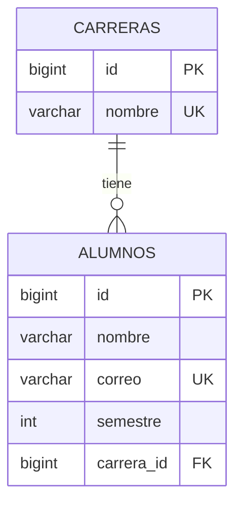
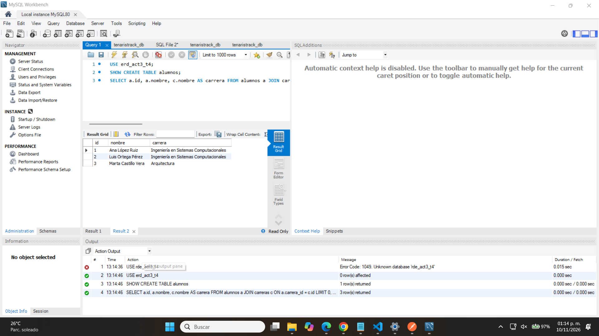
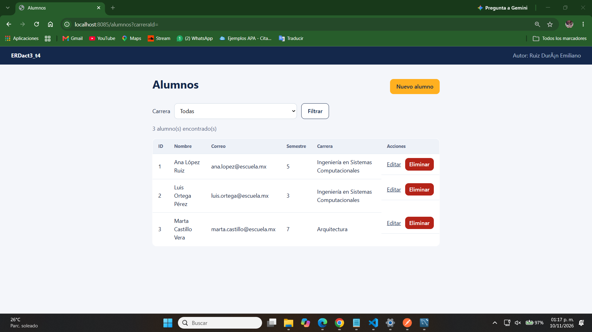
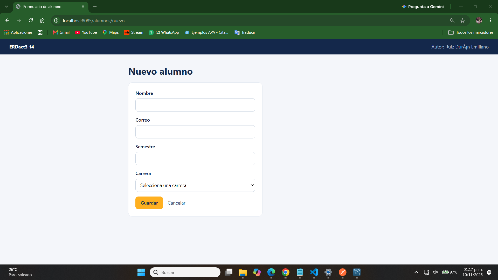
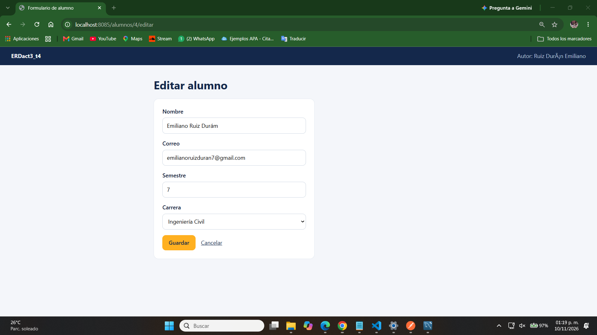
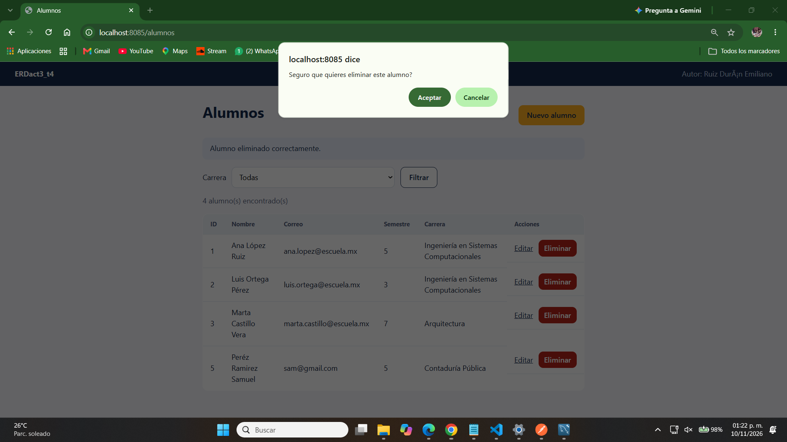
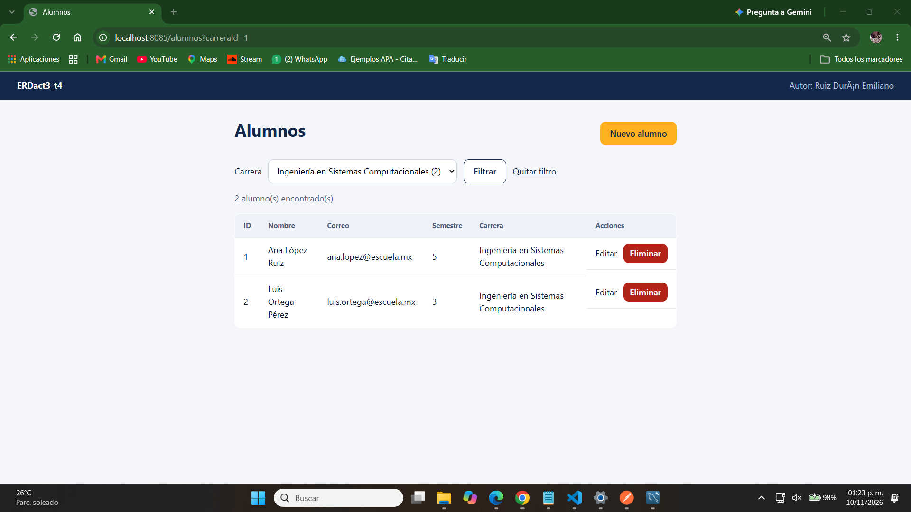
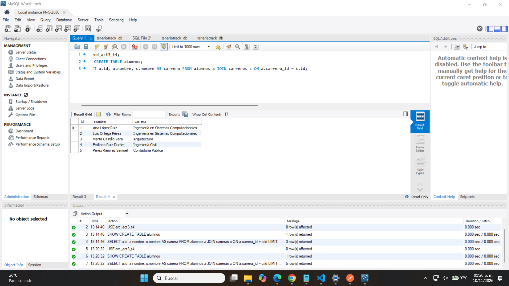

# ERDact3_t4

CRUD completo con **Spring Boot, Spring Data JPA y MySQL**. Maneja dos entidades relacionadas, **Alumno** y **Carrera** (muchos a uno), con una API REST probada en Postman y vistas propias con Thymeleaf, todo dentro del mismo proyecto. Los datos se guardan en una base de datos real, tanto en local como en el VPS.

**Autor:** Ruiz Durán Emiliano

## Qué hace el proyecto

- Administra alumnos (crear, ver, actualizar y eliminar) y cada alumno pertenece a una carrera.
- Al consultar un alumno se muestra el **nombre de su carrera**, no solo su id.
- Desde una carrera se pueden consultar sus alumnos.
- Valida los datos (nombre, correo, semestre y carrera) y responde con mensajes de error claros.
- Los datos persisten en MySQL: al reiniciar la aplicación siguen ahí.

## Entidades y relación

Una **carrera** tiene muchos **alumnos**, y cada **alumno** pertenece a una sola carrera.



| Entidad | Anotaciones de la relación |
|---|---|
| `Alumno` | `@ManyToOne(fetch = LAZY, optional = false)` con `@JoinColumn(name = "carrera_id")`, que crea la llave foránea |
| `Carrera` | `@OneToMany(mappedBy = "carrera")`, el lado inverso de la relación |

## Arquitectura por capas

| Capa | Archivos | Responsabilidad |
|---|---|---|
| Entity | `Alumno`, `Carrera` | Representan las tablas de la base de datos |
| Repository | `AlumnoRepository`, `CarreraRepository` | Acceso a datos con `JpaRepository` |
| Service | `AlumnoService`, `CarreraService` | Lógica de negocio y validaciones |
| DTO | `AlumnoDTO`, `CarreraDTO` | Datos que entran y salen por la API y las vistas |
| Controller | `AlumnoRestController`, `CarreraRestController`, `AlumnoViewController` | Reciben las peticiones y llaman al servicio |
| Exception | `RecursoNoEncontradoException`, `DatosInvalidosException`, `ApiExceptionHandler` | Errores con respuesta 404 y 400 |

Los controladores no tienen lógica de negocio: delegan todo en el servicio.

## Endpoints de la API REST

| Método y ruta | Qué hace | Respuesta |
|---|---|---|
| `GET /api/alumnos` | Lista los alumnos con su carrera | 200 |
| `GET /api/alumnos/{id}` | Un alumno | 200 o 404 |
| `POST /api/alumnos` | Crea un alumno | 201 o 400 |
| `PUT /api/alumnos/{id}` | Actualiza un alumno | 200, 400 o 404 |
| `DELETE /api/alumnos/{id}` | Elimina un alumno | 204 o 404 |
| `GET /api/carreras` | Lista las carreras con su total de alumnos | 200 |
| `POST /api/carreras` | Crea una carrera | 201 o 400 |
| `GET /api/carreras/{id}/alumnos` | Alumnos de una carrera | 200 o 404 |

Ejemplo de `GET /api/alumnos/1`:
```json
{
  "id": 1,
  "nombre": "Ana López Ruiz",
  "correo": "ana.lopez@escuela.mx",
  "semestre": 5,
  "carreraId": 1,
  "carreraNombre": "Ingeniería en Sistemas Computacionales"
}
```

La colección de Postman está en [`postman/ERDact3_t4.postman_collection.json`](postman/ERDact3_t4.postman_collection.json). Se importa en Postman, y la variable `base_url` apunta al servidor.

## Vistas con Thymeleaf

| Ruta | Qué muestra |
|---|---|
| `/alumnos` | Tabla de alumnos con su carrera, filtro por carrera, y botones para editar y eliminar |
| `/alumnos?carreraId=1` | Alumnos de una carrera |
| `/alumnos/nuevo` | Formulario para crear un alumno |
| `/alumnos/{id}/editar` | Formulario para editar un alumno |

## Tecnologías

| Herramienta | Versión |
|---|---|
| Java | 21 |
| Spring Boot | 4.1.2 (Spring Web, Spring Data JPA y Thymeleaf) |
| Base de datos | MySQL |
| Maven | con Maven Wrapper |
| Servidor | VPS de Vultr con Ubuntu |

## Cómo se realizó

### 1. Base de datos local

1. Se instaló MySQL en la computadora y se comprobó que el servicio estuviera corriendo.
2. La aplicación crea la base `erd_act3_t4` si no existe (`createDatabaseIfNotExist=true`).

### 2. Proyecto y dependencias

Se partió del proyecto de la Actividad 2 y se agregaron al `pom.xml` las dependencias `spring-boot-starter-data-jpa` y `mysql-connector-j`.

### 3. Configuración sin credenciales en el repositorio

`application.properties` lee los datos de conexión de variables de entorno, con valores por defecto para uso local:

```properties
spring.datasource.url=${DB_URL:jdbc:mysql://localhost:3306/erd_act3_t4?createDatabaseIfNotExist=true&serverTimezone=UTC}
spring.datasource.username=root
spring.datasource.password=contraseña_de_MYSQL
spring.jpa.hibernate.ddl-auto=update
spring.jpa.open-in-view=false
```

`ddl-auto=update` hace que Hibernate cree las tablas y la llave foránea a partir de las entidades. **La contraseña real nunca se sube al repositorio.**

### 4. Entidades, repositorios y servicios

Se crearon `Carrera` y `Alumno` con la relación, un repositorio por entidad (con consultas derivadas como `findByCarreraId`), y los servicios con las validaciones. Al arrancar, `DataLoader` inserta cuatro carreras y tres alumnos de ejemplo si la base está vacía.

### 5. Controladores y vistas

Se creó el controlador REST con los cuatro endpoints del CRUD, el controlador de carreras y el controlador de vistas con sus dos plantillas.

### 6. Pruebas

Se probó con las vistas y con la colección de Postman, comprobando en MySQL que los datos y la llave foránea realmente se guardaron.

### 7. Despliegue en el VPS

1. Se instaló MySQL: `apt install mysql-server`.
2. Se creó la base y un usuario propio con permisos solo sobre esa base:
```sql
CREATE DATABASE erd_act3_t4 CHARACTER SET utf8mb4 COLLATE utf8mb4_unicode_ci;
CREATE USER 'erd'@'localhost' IDENTIFIED BY '*********';
GRANT ALL PRIVILEGES ON erd_act3_t4.* TO 'erd'@'localhost';
FLUSH PRIVILEGES;
```
3. Se subió el jar a una carpeta nueva, `~/ERDact3_t4/`.
4. En esa carpeta se creó un `application.properties` con los datos reales de la base. Spring Boot lo lee antes que el del jar, y se protegió con `chmod 600`.
5. Se abrió el puerto 8085 en el firewall (`ufw allow 8085/tcp`). El puerto 3306 no se abre al exterior.
6. Se ejecutó con `nohup` en el puerto 8085, sin afectar las actividades anteriores.

## Cómo ejecutarlo en local

Requisitos: JDK 21 y MySQL corriendo.

```powershell
$env:DB_USER = 'root'
$env:DB_PASSWORD = 'contraseña_de_MYSQL'
.\mvnw.cmd spring-boot:run
```

Se abre en http://localhost:8085/alumnos. Para generar el jar: `.\mvnw.cmd clean package -DskipTests` (las pruebas automáticas necesitan una base de datos disponible).

## Capturas de pantalla

**Las dos entidades y la llave foránea en MySQL**



**Leer (Read):** el alumno muestra el nombre de su carrera



**Crear (Create)**



**Actualizar (Update)**



**Eliminar (Delete)**



**Relación: alumnos de una carrera** (`/api/carreras/1/alumnos`)



**Persistencia: los datos están en la base de datos**



## Problemas encontrados y cómo se resolvieron

| Problema | Causa | Solución |
|---|---|---|
| Las pruebas automáticas fallaban al compilar | `contextLoads` necesita conectarse a la base | Se compila con `-DskipTests` |
| La aplicación no arranca en el VPS | Datos de conexión incorrectos en el `application.properties` externo | Se revisaron usuario, contraseña y nombre de la base con `mysql -u erd -p` |
| Error de relación al devolver entidades como JSON | Entidad con relación bidireccional | Se devuelven DTO y no las entidades |

## Enlaces

- Repositorio: https://github.com/23161115-estud/ERDact3_t4
- Proyecto en el VPS: http://216.238.69.868085/alumnos
- API en el VPS: http://216.238.69.86:8085/api/alumnos
- Colección de Postman: [`postman/ERDact3_t4.postman_collection.json`](postman/ERDact3_t4.postman_collection.json)
